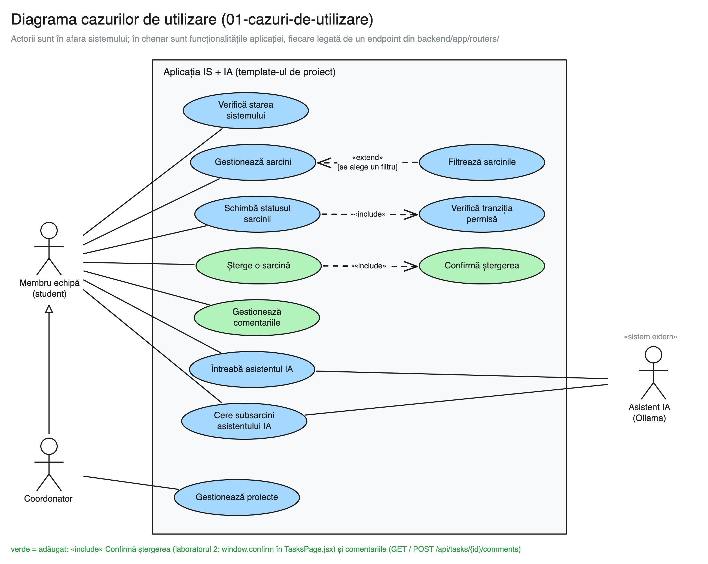
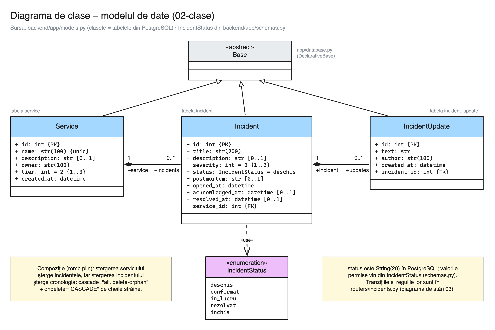
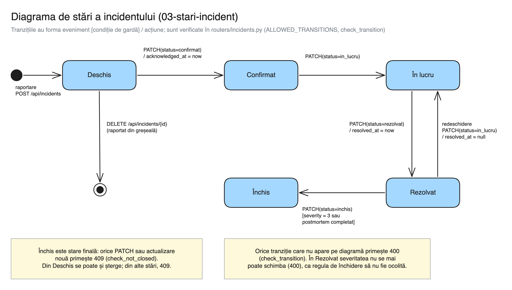
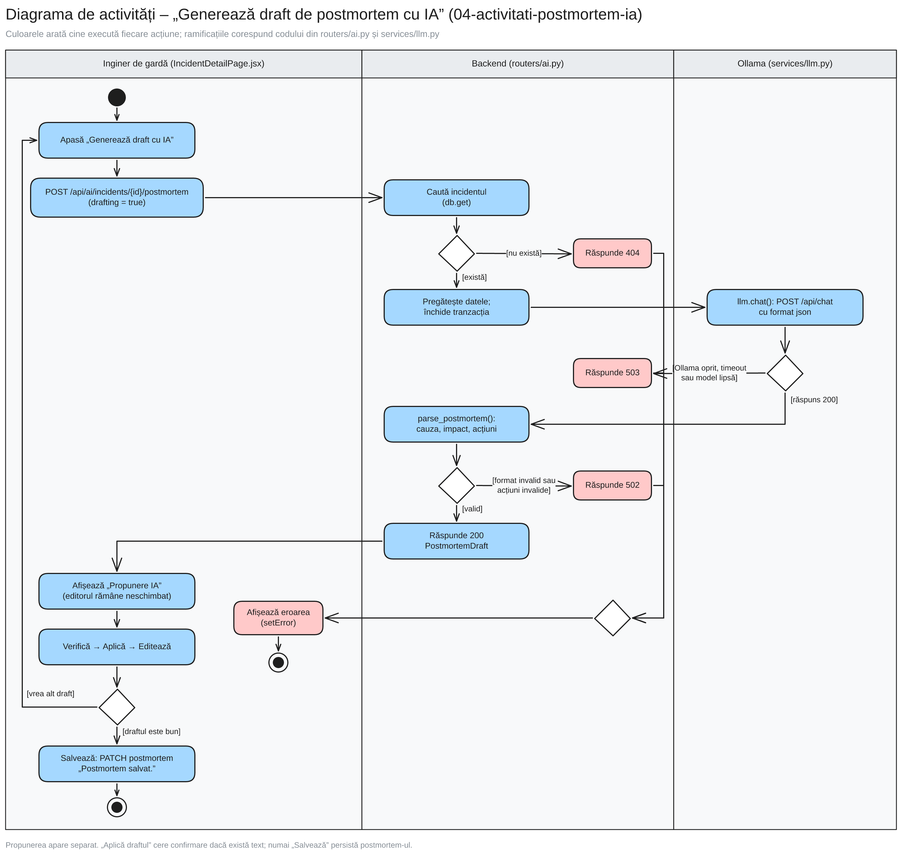
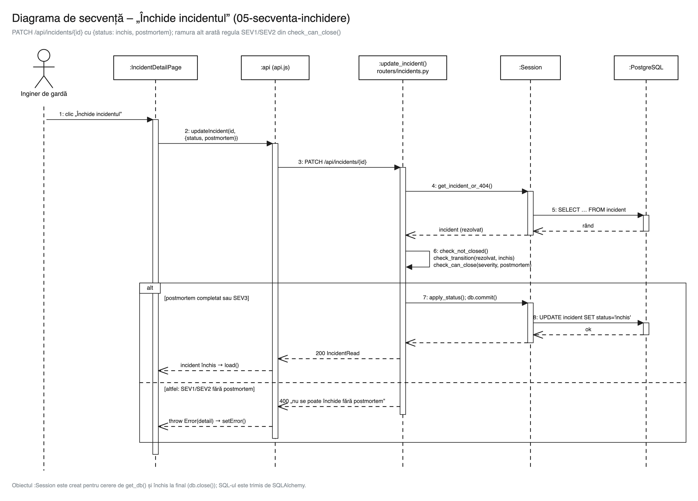
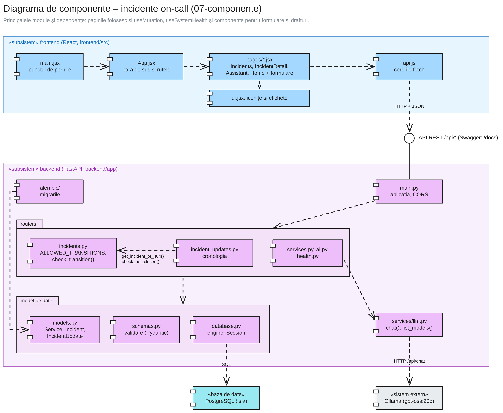
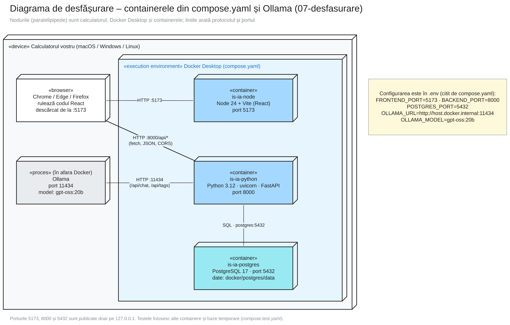

# Incidente on-call – proiect Inginerie software și Inteligență artificială

Proiectul lui Andrei Apostol (branch-ul `apostol.andrei`) pentru laboratoarele de **Inginerie software** și **Inteligență artificială**, Informatică IFR, anul III, 2026–2027, construit pe template-ul disciplinei.
Cadru didactic: Asist. univ. drd. asoc. Cezar-Marian Papară.

Aplicația gestionează incidentele serviciilor unei echipe on-call: raportarea pe servicii, ciclul de viață deschis → confirmat → în lucru → rezolvat → închis (cu regulile verificate în API), cronologia de actualizări și un draft de postmortem propus de un model de limbaj (LLM) care rulează local:

- **backend** – Python 3.12, FastAPI, SQLAlchemy, Alembic, cu bază de date PostgreSQL 17;
- **frontend** – React 19 + Vite;
- **LLM** – Ollama, instalat direct pe calculator (nu în Docker).

Backend-ul, frontend-ul și baza de date rulează în containere Docker; nu este nevoie să instalați Python, Node.js sau PostgreSQL.

## Pornire

```bash
git clone https://github.com/cezarpapara/is-ia-template-ifr3-2026-2027.git
cd is-ia-template-ifr3-2026-2027
git checkout -b feat/nume-prenume
docker compose up -d --build
```

La pornirile următoare: `docker compose up -d`; oprire: `docker compose stop`.

| Container | Ce conține | Adresa |
|---|---|---|
| `is-ia-node` | aplicația React (Vite) | http://localhost:5173 |
| `is-ia-python` | API-ul FastAPI; documentația (Swagger) | http://localhost:8000/docs |
| `is-ia-postgres` | PostgreSQL (pentru DBeaver) | `localhost:5432`, bază/utilizator/parolă `isia` / `isia` / `isia` |

## Structura proiectului

```
.env              configurarea: baza de date, porturile, modelul Ollama
compose.yaml      cele trei containere (folosesc valorile din .env)
backend/          codul Python (FastAPI)
frontend/         codul React
docker/
  python/         Dockerfile-ul containerului is-ia-python
  node/           Dockerfile-ul containerului is-ia-node
  postgres/data/  datele bazei de date (create la prima pornire; nu se urcă pe GitHub)
docs/diagrame/    diagramele UML (.excalidraw + .png; .drawio = exemplele din template)
```

Dacă un port este ocupat sau vreți alt model Ollama, modificați valoarea în `.env`, apoi rulați `docker compose up -d`.
Pentru a porni cu o bază de date goală: `docker compose down`, ștergeți conținutul folderului `docker/postgres/data` (fără fișierul `.gitkeep`), apoi `docker compose up -d`.

Porturile publicate sunt legate de `127.0.0.1`: aplicația este destinată lucrului local, fără autentificare.
După actualizarea codului sau a dependențelor, rulați `docker compose up -d --build` pentru a aplica migrările și configurația nouă. Frontend-ul instalează exact versiunile din `package-lock.json`, prin `npm ci`.

Migrarea istorică `0003` **șterge tabelele `project`, `task` și `comment`, inclusiv datele lor**, înainte de a crea modelul de incidente. Faceți o copie de siguranță dacă folosiți încă date din template. Migrarea `0004` adaugă restricții și indici; dacă găsește date incompatibile, se oprește cu identificatorii înregistrărilor de corectat, fără să le rescrie automat.

## Diagrame UML

Diagramele se află în `docs/diagrame/`; sursa fiecărei imagini este fișierul `.excalidraw` cu același nume. Toate descriu codul de pe acest branch.

### Cazuri de utilizare



Fiecare caz de utilizare se regăsește în aplicație (matricea de trasabilitate):

| Caz de utilizare | Endpoint | Funcția din backend | Pagina React |
|---|---|---|---|
| Verifică starea sistemului | `GET /api/health`, `GET /api/ai/status` | `health()`, `ai_status()` | Starea sistemului (`/stare`), bara de sus |
| Vede incidentele | `GET /api/incidents` | `list_incidents()` | Incidente (`/incidente`) |
| Filtrează incidentele | `GET /api/incidents?service_id=&status=&severity=` | `list_incidents()` | Incidente: filele de status și filtrele |
| Raportează un incident | `POST /api/incidents` | `create_incident()` | Incidente: „Raportează incident” |
| Schimbă statusul incidentului | `PATCH /api/incidents/{id}` | `update_incident()`, `check_transition()` | Incidente (lista de status), Detaliu incident (butoane) |
| Închide incidentul | `PATCH /api/incidents/{id}` cu `status: inchis` | `update_incident()`, `check_can_close()` | Detaliu incident: „Închide incidentul” |
| Adaugă o actualizare în cronologie | `POST /api/incidents/{id}/updates` | `create_update()` | Detaliu incident: Cronologie |
| Scrie postmortem-ul | `PATCH /api/incidents/{id}` cu `postmortem` | `update_incident()` | Detaliu incident: Postmortem |
| Generează draft cu IA | `POST /api/ai/incidents/{id}/postmortem` | `ai_postmortem()` | Detaliu incident: „Generează draft cu IA” |
| Șterge un incident raportat greșit | `DELETE /api/incidents/{id}` | `delete_incident()` | Incidente: butonul de ștergere (`window.confirm`) |
| Întreabă asistentul IA | `POST /api/ai/chat` | `ai_chat()` | Asistent IA (`/asistent`) |
| Gestionează serviciile | `GET`, `POST /api/services` | `list_services()`, `create_service()` | Incidente: tabloul serviciilor și „Adaugă serviciu” |

### Clase

Modelul de date din `backend/app/models.py`: `Service`, `Incident` și `IncidentUpdate`, legate prin compoziții (ștergerea în cascadă).



### Stări

Ciclul de viață al unui incident. Fiecare tranziție este verificată în `backend/app/routers/incidents.py` (`ALLOWED_TRANSITIONS`, `check_transition()`, `check_can_close()`), iar interfața oferă doar tranzițiile permise (`TRANSITIONS` din `frontend/src/api.js`).



### Activități

Fluxul „Generează draft de postmortem cu IA”, pe culoare (pagina, backend-ul, Ollama), cu ramificațiile pentru erorile din `backend/app/routers/ai.py`: 404 (incidentul nu există), 503 (Ollama oprit, timeout sau model lipsă) și 502 (răspuns în format greșit). Propunerea apare separat: o verificați, apăsați „Aplică draftul”, o editați și apoi o salvați.



### Secvență

Cazul „Închide incidentul”, de la clic până la PostgreSQL și înapoi, cu ramura de eroare 400 pentru un incident SEV1/SEV2 fără postmortem.



### Componente și desfășurare

Principalele module frontend/backend și dependențele dintre ele; paginile folosesc și hook-urile comune pentru mutații și starea conexiunilor:



Containerele din `compose.yaml`, porturile lor și Ollama (modelul `gpt-oss:20b`, din `.env`):



## Ollama

Instalați Ollama de pe https://ollama.com și descărcați modelul folosit de proiect (setat în `.env`, `OLLAMA_MODEL`):

```bash
ollama pull gpt-oss:20b
```

Modelul are aproximativ 13 GB. Pe un calculator mai slab puteți pune în `.env` un model mai mic (de exemplu `qwen2.5:1.5b`, modelul implicit al template-ului), apoi rulați `docker compose up -d`.

Pe Linux, Ollama trebuie să accepte conexiuni din Docker: porniți-l cu `OLLAMA_HOST=0.0.0.0 ollama serve`.
Pagina **Starea sistemului** și bara de sus a aplicației arată dacă backend-ul și Ollama funcționează.

## Verificare și evaluare IA

[Ghidul de verificare](docs/verificare.md) descrie testele unitare, integrarea PostgreSQL, testele în browser, pragul de acoperire de 80% și mediul separat de test. Workflow-ul GitHub Actions din `.github/workflows/ci.yml` rulează aceste verificări la push și pull request.

Draftul IA păstrează contractul `cauza`, `impact`, `actiuni`, cu 2–4 acțiuni. Promptul cere diferențierea faptelor, ipotezelor și informațiilor lipsă; datele incidentului sunt tratate ca material de analizat. Validarea structurii JSON nu demonstrează corectitudinea concluziilor: evaluarea include și o rubrică de verificare umană.

[Evaluarea repetată](docs/evaluare-ia/2026-10-11-repeated-report.md) păstrează 36 de încercări pe 12 incidente sintetice, inclusiv opt cazuri noi. Răspunsurile brute, erorile și scorurile asistentului sunt separate de evaluarea umană; seturile, promptul și modelul sunt identificate în manifestul rulării.

Textul de postmortem nesalvat se recuperează în aceeași filă a browserului după reîncărcare. O propunere IA nu înlocuiește automat textul, iar un răspuns întârziat la salvare nu elimină editările mai noi.

## Îndrumarele de laborator

Îndrumarele de laborator (instalare, modul de lucru cu Git, explicarea fiecărui fișier, cerințele proiectului) se găsesc pe grupul Teams al disciplinei.
